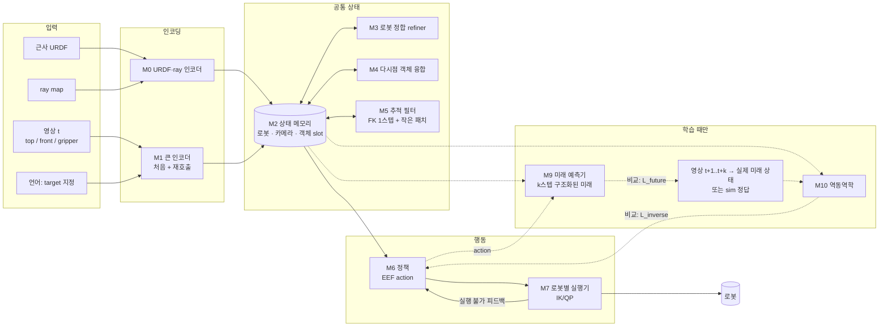
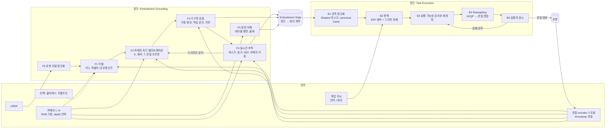

# Cross-Embodiment Policy 아키텍처: 로봇 이해(앞단)와 작업 수행(뒷단)

> 목표: URDF와 카메라 영상만 있으면 **처음 보는 로봇과 처음 보는 카메라**에서도 같은 정책(policy)으로 작업을 수행한다.
> 작성일: 2026-11-25 · 개정: 2026-11-26 (학습 원리와 모델 구조 M0~M10 추가) · 저장소: `/workspace/shadow`

---

## A. 학습 원리 (한 문장)

> **근사 URDF(실제 로봇과 오차가 있음)와, 종류와 위치를 모르는 top·front·gripper 카메라 영상이 주어지면,
> ① 큰 인코더로 처음 한 번 로봇과 task 대상 객체를 찾아 identity를 붙이고,
> ② 그 URDF를 미분 가능한 기구학과 투영으로 각 화면에 겹쳐 보며 카메라 pose, 렌즈, URDF 오차를 잠재 상태로 추론해 모든 카메라를 로봇 베이스라는 하나의 좌표계에 묶고,
> ③ 그 좌표계 안에서 세 화면에 보이는 target 객체를 하나의 3D 점 집합으로 합쳐 identity를 유지한 채 가볍게 추적하고,
> ④ 이렇게 얻은 EEF와 target 사이의 3D 관계만 보고 로봇과 무관한 EEF action을 낸 뒤, 각 로봇의 URDF로 그 action을 관절 명령으로 바꾸며,
> ⑤ 학습 때는 world model처럼 그 action이 만들 k스텝 뒤 각 화면의 로봇과 객체 모습을 예측해 실제로 바뀐 영상과 비교하고, 반대로 화면 변화로부터 action을 맞히게 해서 action과 영상 변화의 정렬을 상태 안에 새기되, 추론 때는 이 미래 예측을 떼어 내고,
> ⑥ 이 모든 것을 수천 종의 무작위 로봇, 카메라, URDF 오차 위에서 학습시켜, 처음 보는 로봇과 카메라에서도 같은 원리로 동작하게 한다.**

핵심 분담은 두 가지다.
- **구조로 고정하는 것 (inductive bias):** 기구학(FK), 투영, 공통 좌표계, slot 단위 identity. 모든 로봇과 카메라에 공통이다.
- **학습하는 것:** "구조가 만든 가설"과 실제 영상의 차이를 읽고 고치는 능력, 그 상태 위에서 작업을 판단하는 능력, 그리고 action이 영상을 어떻게 바꾸는지에 대한 감각이다. 마지막 감각은 학습 때만 쓰는 미래 예측으로 만든다.

### A.1 구절 → 모듈 매핑

| 구절 | 모듈 | 구조로 고정된 부분 | 학습하는 부분 | 학습 | 추론 |
|---|---|---|---|:-:|:-:|
| "근사 URDF와, 종류·위치를 모르는 카메라 영상이 주어지면" | **M0 입력 인코더** · URDF 그래프 인코더 · 픽셀별 광선 방향(ray map) 임베딩 | 관절당 토큰 1개(부모/자식, 축, 한계) + 링크 메시 점. 관절 수와 무관한 그래프 구조. 렌즈는 픽셀별 광선으로 표현 | 토큰 임베딩 | ✓ | ✓ |
| ① "큰 인코더로 처음 한 번 로봇과 target을 찾아 identity를 붙이고" | **M1 큰 인코더 (찾기)** · ViT 영상 인코더 · 언어로 target 지정 ("흰 블럭") | 처음과 재호출 조건에서만 실행 (추적 실패, 재등장, 카메라 급변, 새 task, 1~2초 주기 점검) | 초기 seg, "이 영역이 몇 번 링크 / target"이라는 identity | ✓ | 가끔 |
| "identity를 유지한 채" (전체에 걸침) | **M2 공통 상태 메모리** | slot 하나 = 개체 하나 (로봇, 카메라 각각, 객체 각각). 프레임이 지나도 slot이 이어짐. 좌표는 모두 로봇 베이스 기준 | slot 특징 벡터 (외형, 불확실도) | ✓ | ✓ |
| ② "URDF를 화면에 겹쳐 보며 카메라·렌즈·URDF 오차를 추론해 하나의 좌표계로 묶고" | **M3 로봇 정합 refiner** | **미분 가능 FK + 투영 + 점 렌더**로 "이 상태라면 이렇게 보여야 한다"는 가설을 만듦. gripper cam pose = FK × 손-카메라 변환 | 가설과 영상 특징의 차이 → Δ(카메라 pose, 렌즈, 링크 길이, 관절 영점, 링크별 잔차 SE(3)). 2~4회 반복 | ✓ | ✓ |
| ③ "세 화면의 target을 하나의 3D 점 집합으로 합쳐 가볍게 추적하고" | **M4 다시점 객체 융합** **M5 추적 필터** | M4: 3D 객체 query를 각 카메라에 투영해 특징 샘플링 (DETR3D 방식, depth 불필요) M5: 다음 프레임의 로봇 위치를 FK로 1스텝 예측. 잡은 객체는 EEF에 붙임 | M4: 시점별 가시성과 신뢰도 가중치, Δ(점, pose, 크기), 가려진 부분 형상 보완, 시점 간 같은 객체 판단 M5: 예측 주변 작은 패치로 보정하는 가벼운 인코더, 예측과 관측의 혼합 비율, M1 재호출 판단 | ✓ | ✓ |
| ④ "EEF–target 3D 관계만 보고 로봇과 무관한 EEF action을 내고" | **M6 정책** | 입력에 관절 정보가 없음: EEF pose, 그리퍼 폭, 객체 점(베이스 기준 + EEF 기준), 불확실도 → 구조적으로 로봇에 무관 | EEF action chunk + 그리퍼 폭 (Diffusion Policy 계열), 자세 허용치 | ✓ | ✓ |
| "각 로봇의 URDF로 그 action을 관절 명령으로 바꾸며" | **M7 로봇별 실행기** | IK/QP, 관절 한계, 충돌, 그리퍼 폭 → 관절값 매핑 | (선택) 잔차 보정. 실행할 수 없으면 정책에 알림 (IK 잔차, 도달 불가) | ✓ | ✓ |
| ⑤-a "그 action이 만들 k스텝 뒤 각 화면의 모습을 예측해 실제로 바뀐 영상과 비교하고" | **M9 미래 예측기 (순방향 world model)** | 예측 경로 자체가 구조: EEF action → M7 IK → Δq → FK → 각 카메라로 투영. 픽셀이 아니라 **구조화된 미래**(로봇 seg/link 점, 객체 점/seg, EEF)를 예측 | 계산이 못 하는 잔차: 지연, 백래시, 휨, 객체가 밀리거나 굴러가는 움직임, 접촉 후 객체 변화 | ✓ | **제거** |
| ⑤-b "반대로 화면 변화로부터 action을 맞히게 해서" | **M10 역동역학** | 입력: s_t, s_t+k / 출력: 그 사이의 EEF action (M6과 같은 action 공간) | 화면 변화 → action | ✓ | **제거** |
| ⑤-c "action과 영상 변화의 정렬을 상태 안에 새기되, 추론 때는 미래 예측을 떼어 내고" | **M2 상태 (결과)** | M9, M10은 M2의 상태만 입력으로 받음 → 미래를 맞히려면 상태가 action의 결과를 담아야 함 | 그 결과로 M2~M6의 표현이 action을 알게 됨 | — | 상태만 남음 |
| ⑥ "수천 종의 무작위 로봇·카메라·URDF 오차 위에서 학습" | **M8 데이터 엔진 + 손실** | 세계는 정답 URDF로 만들고 모델에는 **오차를 섞은 URDF**를 줌 (A.4) | (학습 대상 아님) M0~M10 전체를 학습시킴 | ✓ | — |
| "처음 보는 로봇과 카메라에서도" | 평가 (7장) | 학습에서 뺀 실제 URDF 로봇(so101, ur7e, piper, panda)과 카메라 | — | — | — |

### A.2 학습 경로와 추론 경로

- **추론 경로 (실선):** M0 → M1(가끔) → M2 ↔ M3/M4/M5 → M6 → M7.
- **학습 전용 (점선):** M9, M10과 미래 프레임. 학습이 끝나면 떼어 낸다.
- **주의:** M5의 1스텝 FK 예측은 "상상하는 미래"가 아니라 추적용 사전 위치다. μs 수준으로 싸고, 이것이 있어야 큰 인코더를 매 프레임 부르지 않아도 된다. 그래서 추론 때도 유지한다. M9는 k스텝 장면 전체를 학습 모델로 예측하므로 추론 때 뺀다.

### A.3 손실

| 손실 | 대상 모듈 | 비교 | 실제 영상에서도 쓸 수 있는가 |
|---|---|---|---|
| L_seg, L_identity | M1 | 로봇과 객체의 seg, 링크/target 라벨 | 아니오 (sim 정답) |
| L_register | M3 | 카메라 pose, 렌즈, URDF 보정량, link 2D 점 | 일부. 가설 렌더와 영상 특징의 일치도는 라벨 없이 가능 |
| L_object | M4 | 객체 3D 점, pose, 크기 | 일부. 시점 간 투영 일관성은 라벨 없이 가능 |
| L_track | M5 | 프레임 간 상태 오차 | 일부 |
| L_policy | M6 | 시연 action (모방). 이후 task 성공 여부 (강화학습) | 시연이 있으면 가능 |
| **L_future** | M9 → M2 | 예측한 k스텝 뒤 로봇 seg/link 점, 객체 점/seg, EEF ↔ 실제 미래 프레임에서 뽑은 값 | **예.** 실제 미래 프레임이 곧 정답이라 라벨이 필요 없음 |
| **L_inverse** | M10 → M2 | 추정한 action ↔ 실제 실행한 action | **예.** 실행 기록만 있으면 됨 |
| L_cross-view | M4, M9 | 같은 미래를 top/front/gripper에서 따로 예측한 결과의 일관성 | 예 |

- 비교는 픽셀이 아니라 구조화된 표현(seg, 점)에서 한다. 외형까지 비교할 때는 DINO 특징 공간까지만 쓴다. 픽셀 영상 생성은 하지 않는다.
- L_future와 L_inverse는 라벨이 필요 없으므로, 처음 보는 실제 로봇을 조금 움직여 보며 적응(test-time adaptation)할 때도 쓸 수 있다.

### A.4 데이터 엔진의 핵심 장치 (M8)

| 축 | 내용 |
|---|---|
| 로봇 | 절차적 생성 로봇 수천 종 (관절 3~7개, 링크 길이·축 무작위, 그리퍼 부착) + 공개 실제 URDF. 실제 URDF 일부는 평가용으로만 남김 |
| **URDF 오차** | 링크 길이 ±10%, 관절 영점 ±5°, 메시를 단순 도형으로 교체, 그리퍼·부착물 누락, 케이블 추가. **세계는 정답, 모델 입력은 오차가 섞인 URDF** |
| 기구 오차 | 백래시, 휨, 명령 지연, encoder 노이즈 |
| 카메라 | 위치, 각도, 높이, 화각 45~175°, pinhole/Brown/fisheye, 해상도, 화질 저하, 실시간 이동과 흔들림 |
| 객체와 장면 | 흰 블럭 + 흰 테이블 같은 저대비, 같은 모양 객체 여러 개, 팔에 의한 가림, gripper cam에 일부만 보이는 경우, 배경·조명 |
| 연산 | FK, 투영, 점 렌더, IK는 torch 배치 연산 (RT core와 외부 시뮬레이터 불필요). 접촉 물리는 MuJoCo CPU로 일부 검증에만 사용 |

### A.5 기존 기능 설계(3~5장)와의 대응

3~5장의 F/B 단계는 "무엇을 해야 하는가"를 기능별로 적은 것이다. A장의 M 모듈은 그 기능을 하나의 학습 모델로 묶은 것이다.

| 기능 단계 (3~5장) | 담당 모듈 |
|---|---|
| F0 로봇 모델 정규화 | M0 (URDF 그래프화), M8 (오차 주입) |
| F1 식별 | M1 (+ M9의 "명령대로 움직이는 것이 내 로봇" 신호) |
| F2 카메라 자기 캘리브레이션 | M3 (카메라 상태는 별도 절차 없이 잠재 상태로 계속 추론) |
| F3 기구학 검증 | M3 (URDF 보정량), M7 (한계, 작업 공간) |
| F4 실시간 추적 | M5 (+ M3의 반복 보정) |
| F5 장면 이해 | M4 |
| B1 관측 정규화 | M2 → M6 입력 (구조화된 상태라서 Shadow식 영상 마스킹은 선택 사항) |
| B2 정책 | M6 |
| B3 실행 가능성 검사, B4 retargeting | M7 |
| B5 실행과 감시 | M5 + M7 (예측과 관측의 차이로 실패 감지) |
| 5장 L1~L6 | L1·L2 → M1, L3·L5 → M3, L4 → M0(ray map) + M3, L6 → M6 |
| (신규) | M9 미래 예측기, M10 역동역학: 학습 전용 |

### A.6 inductive bias의 효과를 검증하는 비교 실험

| 모델 | 내용 |
|---|---|
| A. 블랙박스 | 영상 + URDF 토큰 → seg, 점, 미래, action을 직접 출력 (FK·투영 구조 없음) |
| B. 순수 계산 | 현재 저장소 파이프라인 (체커보드 캘리브레이션 + twin + IK) |
| C. 구조 + 학습 | M0~M10 |
| C − M9/M10 | 미래 예측 학습을 뺀 C (world model식 학습의 효과 측정) |

지표는 세 가지다. 학습에서 뺀 로봇에서의 seg IoU·점 오차·task 성공률, URDF 오차 크기에 따른 성능 저하, 학습 로봇 수에 따른 일반화 곡선.

---

## 0. 설계 원칙

1. **로봇에 따라 달라지는 계산은 출력이 아니라 모델 안의 구조로 넣는다.**
   로봇별 정보(형상, 기구학, 관절 한계)는 URDF에서 온다. 이 정보로 FK·투영 가설을 만드는 것은 고정된 구조이고, 가설과 실제의 차이(URDF 오차, 렌즈, 화질, 가림)를 고치는 것은 학습한다. 로봇마다 네트워크를 새로 학습하는 구조는 쓰지 않는다 (A장).
2. **카메라에 대해서도 아무것도 가정하지 않는다.**
   내부 파라미터, 렌즈 왜곡, 해상도, 화질, 위치는 모두 모르는 값이다. 실행 중에 바뀔 수도 있다. depth가 없는 RGB가 기본이고, depth가 있으면 추가 정보로만 쓴다.
3. **앞단과 뒷단은 로봇에 독립적인 표현으로만 연결한다.**
   앞단은 로봇을 이해해서 "로봇과 무관한 표현"으로 바꿔 넘긴다. 뒷단은 그 표현 위에서만 작업을 결정한다. 결정된 동작은 마지막 단계(retargeting)에서 다시 해당 로봇의 관절 명령으로 바꾼다.
4. **로봇이 누구인지는 움직임으로 확정한다.**
   "내가 명령한 대로 움직이는 물체가 내 로봇"이다. 이 원리로 로봇을 찾고 계속 추적한다. 화면에 로봇이 여러 대 있어도 섞이지 않는다.
5. **정답(oracle) 정보는 학습 라벨과 평가에만 쓴다.**
   sim의 정답 pose, 정답 마스크, 완벽한 depth는 실행 경로에 들어가면 안 된다.

---

## 1. 전체 구조

**동작 흐름**
- **최초 연결(bring-up):** F0 → F1 → F2 → F3 순서로 한 번 수행한다. 수십 초에서 몇 분이 걸리고, 로봇이 작은 탐색 동작을 한다.
- **운용 중:** F4와 F5가 매 프레임 돈다. 카메라가 움직여도 F4가 추적한다. 추적이 흔들리면 F2를 부분적으로 다시 수행한다.
- **작업:** 뒷단(B1~B5)이 Embodiment State를 받아 정책 → 실행 가능성 검사 → 관절 명령 변환 → 실행 → 감시를 반복한다.

---

## 2. 앞단과 뒷단 사이의 계약: Embodiment State

앞단이 뒷단에 넘기는 정보 전체다. 뒷단은 이 정보만 보고 동작한다. 모든 값에는 **불확실도**를 함께 붙인다.

| 구분 | 항목 | 설명 |
|---|---|---|
| 정적 (bring-up 때 확정) | `robot` | 기구 그래프, 팔 관절, 그리퍼 관절, EEF/TCP 정의, 메쉬 |
| | `joint_limits` | URDF 값과 **실측으로 확인한 값** (소프트 한계, 속도 한계) |
| | `joint_offsets Δq` | encoder 영점 오차 추정치 |
| | `gripper` | 종류(평행/회전/흡착), 개폐 폭 ↔ 관절값 매핑, 접촉점 |
| | `workspace` | 도달 가능 영역 (복셀 맵, 영역별 가능한 접근 방향) |
| | `latency` | 명령 → encoder → 영상 사이의 지연 |
| 카메라별 (변할 수 있음) | `camera_model` | K, 왜곡 모델과 계수, 해상도 |
| | `T_base_cam` | 카메라 pose (손목 카메라는 `T_link_cam`) |
| | `health` | 마스크 일치도, 재투영 잔차, 마지막 캘리브레이션 시각 |
| 프레임별 | `mask_amodal`, `mask_visible` | 로봇 전체 실루엣 / 실제로 보이는 부분 |
| | `link_kp_2d/3d` | 링크(관절) 위치. skeleton |
| | `eef_pose` | base frame과 각 카메라 frame에서의 TCP pose와 그리퍼 개폐 폭 |
| | `scene` | 테이블 평면, 물체 마스크와 3D 위치 (F5) |

이 계약은 현재 웹 데모가 화면에 표시하는 값(마스크, skeleton, 카메라 오차, IoU)의 상위 집합이다.

---

## 3. 앞단: Embodiment Grounding

### F0. 로봇 모델 정규화
- **입력:** URDF (xacro면 펼친 결과).
- **처리:**
  - 메쉬 경로를 해석하고 형식을 변환한다 (DAE → OBJ).
  - mimic 관절을 equality 제약으로 바꾼다.
  - 고정 링크를 보존해서 tool frame을 유지한다.
  - 팔과 그리퍼를 자동으로 구분한다. 말단 쪽에서 prismatic/mimic 관절이 있는 부분을 그리퍼 후보로 본다.
  - TCP와 접근 축을 자동 추정한다. 손가락 끝의 중점을 TCP로, 손가락 쪽 방향을 접근 축으로 잡는다. 사람이 yaml로 덮어쓸 수 있다.
- **출력:** 정규화된 로봇 모델 (MuJoCo MJCF와 운동학 그래프).
- **현재 상태:** `shadow/urdf_robot.py`에 구현되어 있다. 팔/그리퍼 구분과 TCP는 아직 yaml에 손으로 적는다 → 자동 추정으로 바꿔야 한다.

### F1. 식별: "어느 픽셀이 내 로봇인가"
- **프롬프트가 있을 때:** 클릭/박스를 SAM2 영상 분할에 넣어 마스크를 얻고 추적한다.
- **프롬프트가 없을 때:**
  1. 안전한 범위에서 **들뜸 동작(excitation motion)** 을 한다. 관절별로 작은 진폭의 사인파를 서로 다른 주파수로 준다.
  2. 영상에서 point tracking (CoTracker 계열)을 돌린다.
  3. 각 점의 움직임과 관절 속도의 상관을 계산해서 로봇 영역을 찾는다. 이 단계는 카메라 파라미터를 몰라도 된다.
  4. 주파수가 관절마다 다르므로 **점마다 어느 링크에 속하는지**까지 함께 나온다. 이것이 F2의 강한 단서가 된다.
- **보조 수단:** 텍스트 프롬프트 기반 검출기("robot arm")로 후보 영역을 좁힌다.
- **출력:** 로봇 마스크 트랙, 링크별로 라벨이 붙은 추적점.

### F2. 카메라 자기 캘리브레이션 (체커보드 없이, 내부 파라미터도 모르는 상태에서)
- **추정 대상:** 카메라 모델(K, 왜곡), `T_base_cam`, 관절 오프셋 Δq, (필요하면) 시간 지연.
- **초기화:**
  - 단일 이미지 캘리브레이션 네트워크(GeoCalib 계열)로 초점거리와 왜곡의 사전 분포를 얻는다.
  - 학습된 **후보 점수기**로 카메라 pose를 대략 잡는다. URDF를 여러 시점 후보로 렌더링하고, 이미지와 가장 비슷한 후보를 고르는 방식이다.
- **정밀화:**
  - 한 시간 창 안의 여러 프레임에 대해 다음을 함께 최소화한다.
    - 실루엣 차이 (미분 가능 렌더링, nvdiffrast)
    - 링크 라벨이 붙은 추적점의 재투영 오차 (URDF의 FK와 결합)
    - depth 차이 (depth가 있을 때만)
  - 학습된 **렌더-비교 refiner**(5장)가 수렴 범위를 넓히고 속도를 높인다.
- **능동 탐색:** 관측만으로는 구분되지 않는 값들이 있다.
  - 초점거리와 거리 → 깊이 방향 변화가 있어야 구분된다.
  - 왜곡 → 화면 가장자리에서만 드러난다.
  - 대칭인 자세 → 여러 자세를 봐야 구분된다.
  - 그래서 **추정 불확실도를 가장 많이 줄이는 관절 자세**를 다음에 고른다 (EasyHeC의 자세 선택과 같은 생각). F3의 안전 범위 안에서만 고른다.
- **출력:** 카메라 모델, pose, Δq, 각각의 공분산.
- **현재 상태:** 체커보드 + hand-eye + bundle adjustment가 `shadow/calibration.py`에 있다. 내부 파라미터 고정 재캘리브레이션과 작업공간 샘플링도 있다. 이제 **체커보드 코너를 로봇의 실루엣과 추적점으로 대체**하는 것이 다음 작업이다.

### F3. 기구학 검증: 가동 범위와 작업 공간
- **관절 방향과 부호 검증:** 관절을 하나씩 움직이고, 영상에서 해당 링크가 URDF 예측 방향으로 움직이는지 확인한다. URDF 오류나 배선 오류를 잡는다.
- **실제 가동 범위:** URDF 한계 안쪽에서 저속으로 한계 근처까지 접근한다. encoder 포화, 전류 상승, 영상상 충돌을 감지해서 **소프트 한계**를 확정한다. 처음 연결할 때만 수행하고, 사람의 승인을 받는다.
- **작업 공간 지도:**
  - 확정된 한계, 자기 충돌(URDF), 환경 충돌로 IK를 샘플링해서 복셀 맵을 만든다. 환경은 F5의 테이블 평면이나 depth로 얻는다.
  - 각 복셀에는 가능한 접근 방향의 집합과 조작성(manipulability)을 저장한다. 5축 팔이 어떤 방향으로는 집을 수 없다는 사실이 여기서 드러난다.
- **동역학 특성:** 명령에서 encoder, 영상까지의 지연과 추종 대역폭을 계단 응답으로 측정한다.
- **현재 상태:** DLS IK와 위치 우선 fallback(`shadow/ik.py`)만 있다. 나머지는 새로 만든다.

### F4. 실시간 추적
- **매 프레임 처리:**
  1. 관절값을 영상 시각으로 보간해서 twin을 렌더링한다.
  2. refiner를 1~2회 돌려 카메라 pose를 갱신한다 (움직이는 카메라 대응).
  3. SE(3) 필터(EKF 등)로 매끄럽게 한다.
- **출력:** amodal/visible 마스크, skeleton, EEF pose.
  - visible 마스크: depth가 있으면 depth 비교로 가림을 판정한다. 없으면 학습된 분할로 판정한다.
- **로봇이 가려지거나 화면 밖일 때:** 배경 특징점으로 카메라 이동만 추적한다 (visual odometry).
- **드리프트 감지:** twin과 관측 마스크의 일치도, 재투영 잔차를 계속 감시한다. 임계값을 넘으면 F2를 부분적으로 다시 수행한다. 현재 웹 데모의 restart 버튼을 자동으로 누르는 것에 해당한다.
- **목표 성능:** 카메라당 20ms 이하 (3090 기준).
- **현재 상태:**
  - 정답 관절값으로 twin을 렌더링하는 것, depth 기반 가림 판정, skeleton은 `webapp/server.py`에 구현되어 있다.
  - 하지만 카메라 pose는 **추적하지 않고 고정**되어 있다. 카메라가 움직였는지도 정답 pose와 비교해서 판단하고 있다 → refiner 기반 추적으로 바꿔야 한다.

### F5. 장면 이해 (뒷단이 쓸 물체 정보)
- 테이블 평면: depth가 있으면 depth로, 없으면 로봇이 테이블을 살짝 짚는 동작으로 높이를 측정한다.
- 물체: open-vocabulary 검출과 분할을 한다. 3D 위치는 다중 카메라 삼각측량, depth, 또는 테이블 평면 가정으로 구한다.
- 모든 결과를 **로봇 base frame**으로 표현해서 Embodiment State에 넣는다.

---

## 4. 뒷단: Task Execution

### B1. 관측 정규화: 로봇에 독립적인 입력 만들기
뒷단 정책에는 로봇의 생김새가 드러나지 않아야 한다. 두 가지 방식을 쓰고, 둘을 함께 쓰는 것을 기본으로 한다.
- **시각 입력 (Shadow 방식):**
  - F4의 visible 마스크로 로봇 픽셀을 지운다.
  - 그 자리에 **canonical 로봇의 그림자**를 합성한다. 그림자는 학습에 쓴 로봇 집합의 합성 마스크이거나, 그리퍼만 단순화한 형상이다.
  - Mirage 방식처럼 inpainting을 하지 않으므로 생성 오차가 없다.
- **상태 입력:**
  - EEF pose (TCP의 SE(3))와 정규화한 그리퍼 개폐 폭(0~1).
  - 좌표계는 **task frame**이다. 테이블 평면과 작업 영역 중심으로 정의한다. 로봇 base frame은 로봇마다 다르므로 쓰지 않는다.
- **선택 입력: embodiment descriptor.** 작업 반경, 자유도, 그리퍼 종류, F3의 작업 공간 요약을 조건으로 넣는다. 정책이 "이 로봇은 이 방향으로는 못 집는다"를 알게 하려는 것이다.

### B2. 정책
- **출력:** task frame에서의 EEF 궤적 조각(action chunk)과 그리퍼 개폐 폭. 관절 공간 출력은 쓰지 않는다. 관절 공간은 로봇마다 다르기 때문이다.
- **모델 후보:** Diffusion Policy (Shadow 논문에서 검증된 기준선), 또는 언어 조건이 필요하면 VLA 계열.
- **학습 데이터:**
  1. sim 데이터 엔진의 여러 로봇 × 여러 카메라 데모. B1의 정규화를 적용한 상태로 쓴다.
  2. 실제 로봇 데모 (텔레오퍼레이션).
  3. (선택) Masked Visual Actions처럼 렌더링한 로봇 마스크를 행동 표현으로 쓰는 world model로 계획을 평가하거나 데이터를 증강한다.

### B3. 실행 가능성 검사와 재계획
- 정책이 낸 EEF 궤적을 F3의 작업 공간 지도, 관절 한계, 충돌 모델로 검사한다.
- 불가능하면 다음 순서로 처리한다.
  1. 접근 방향을 바꾼다 (같은 파지점, 다른 orientation).
  2. 경유점을 추가한다.
  3. 시간 축을 다시 늘린다 (속도 한계).
  4. 그래도 안 되면 정책을 다시 샘플링하거나 하위 목표를 다시 계획한다.
- 자유도가 부족한 팔(예: SO-101, 5축)은 **위치를 우선**하고 자세는 가능한 범위로 투영한다. 현재 IK fallback과 같은 규칙이다.

### B4. Retargeting: EEF 명령 → 관절 명령
- 가중 IK 또는 QP로 푼다. 제약은 관절 한계, 속도 한계, 자기 충돌, 테이블 충돌이다. null-space에서는 기본 자세를 유지한다.
- 그리퍼: 정규화된 개폐 폭을 F0/F3의 그리퍼 매핑으로 관절값으로 바꾼다. mimic 관절과 흡착 그리퍼는 매핑만 다르다.
- 관절 오프셋 Δq와 지연 보상을 여기서 반영한다.
- **현재 상태:** `shadow/ik.py` (DLS, 위치 우선)와 웹 데모의 computed-torque PD가 있다.

### B5. 실행과 감시
- 제어 주기(예: 100Hz 이상)로 관절 명령을 보낸다. 정책은 더 느린 주기(5~10Hz)로 action chunk를 갱신한다.
- **시각 servo 보정:** F4가 영상에서 본 EEF와 명령한 EEF의 차이를 감시한다. 차이가 크면 캘리브레이션이나 기구학 오차로 판단해서 보정하고 F2에 알린다.
- **실패 감지:** 파지 실패(그리퍼 개폐 폭, 영상), 충돌, 추종 오차를 감지하면 B3로 돌아간다.

---

## 5. 학습하는 부분

| # | 모델 | 입력 | 출력 | 로봇/카메라에 독립적인 이유 |
|---|---|---|---|---|
| L1 | 렌더 조건부 분할 | 영상, twin 렌더(어긋나 있어도 됨) | 정확한 로봇 마스크 (visible/amodal) | 로봇 정보는 렌더로만 들어감. URDF에 없는 케이블/커버도 잡음 |
| L2 | 후보 점수기 | 영상, 후보 pose의 렌더 N개 | 가장 가까운 후보 | 위와 같음 |
| L3 | **렌더-비교 refiner** (핵심) | 영상 crop, 현재 추정의 렌더(마스크·normal·depth·**링크 ID**), ray map | ΔT, Δq, (Δf, Δ왜곡) | URDF 렌더와 픽셀별 광선 방향으로 조건화 |
| L4 | 단일 이미지 카메라 사전 | 영상 | 초점거리와 왜곡의 분포 | 카메라 일반 지식 (사전 학습 모델 활용) |
| L5 | 링크 대응 (선택) | 영상, 렌더 | 픽셀별 (링크 ID, 링크 좌표 3D) | PnP-RANSAC과 FK로 초기화를 보강 |
| L6 | 정책 | 정규화된 관측 (B1) | EEF action chunk | 앞단이 로봇과 무관한 표현으로 바꿔 줌 |

- L3 학습: 정답 pose에 섭동을 준 뒤 되돌리게 한다. 손실은 로봇 표면 점들의 거리 오차. 반복 적용을 전제로 학습한다 (MegaPose/FoundationPose 방식을 관절 로봇으로 확장).
- 일반화 평가: **학습에 쓰지 않은 로봇과 학습에 쓰지 않은 카메라 모델**로만 성능을 보고한다.

---

## 6. 데이터 엔진 (sim)

현재 저장소의 sim이 출발점이다.

| 축 | 무작위화 범위 | 현재 상태 |
|---|---|---|
| 로봇 | 공개 URDF 수십~수백 개 + 링크 길이·형상을 무작위로 만든 가상 팔 | URDF 4종 (`configs/robots/`) |
| 카메라 모델 | 핀홀/Brown/fisheye, 화각 45~175°, 해상도, 주점 | 구현됨 (`shadow/camera_model.py`) |
| 화질 | 노출, 화이트밸런스, 비네팅, 블러, 노이즈, 저해상도, JPEG | 구현됨 (`degrade`) |
| 카메라 배치·이동 | 고정 / 사람이 옮김 / 연속 이동 궤적 / 손목 장착 | 고정과 수동 이동 |
| 실제 오차 | encoder 오프셋·백래시·지연, CAD와 실물 차이(링크 길이 ±, 미지의 부착물), depth 노이즈·결측 | 아직 없음 |
| 장면 | 테이블, 물체, 방해물, 가림(사람 손), 조명, 배경 | 기본 장면만 |
| 작업 | pick/place, push, stack 등 + 스크립트 데모 | 아직 없음 |

모든 샘플에는 정답 라벨(마스크, 링크 ID, 카메라 모델, pose, 관절값)을 함께 저장한다. 실행 경로에서는 이 정답에 접근하지 못하게 인터페이스를 나눈다 (`RealWorld` 대 `Observation`).

---

## 7. 평가

| 범위 | 지표 |
|---|---|
| F1 식별 | 마스크 IoU, 로봇이 여러 대일 때 식별 정확도, 소요 시간 |
| F2 캘리브레이션 | 카메라 pose 오차 (mm/°), 초점거리·왜곡 오차, 재투영 오차, 소요 시간, 탐색 동작 수 |
| F3 기구학 | 한계 추정 오차, 작업 공간 지도의 정밀도/재현율 |
| F4 추적 | 카메라가 움직일 때 pose 오차, amodal/visible IoU, skeleton 픽셀 오차, 지연(ms), 추적을 놓친 뒤 복구 시간 |
| 전체 | 작업 성공률. 세 조건으로 나눠 본다: (a) 학습에 쓴 로봇과 카메라, (b) 학습에 쓰지 않은 카메라, (c) 학습에 쓰지 않은 로봇 |
| 민감도 | 캘리브레이션 오차를 인위로 넣었을 때 성공률이 어떻게 변하는지 (Shadow 논문의 1cm/5° 실험의 확장) |

---

## 8. 현재 저장소와의 대응

| 모듈 | 파일 | 상태 |
|---|---|---|
| F0 | `shadow/urdf_robot.py`, `configs/robots/*.yaml` | 동작. 그리퍼/TCP 자동 추정 필요 |
| 장면/sim | `shadow/mj_world.py` | 동작. 실제 오차 모델 추가 필요 |
| 카메라 모델 | `shadow/camera_model.py` | 동작 (렌더링 검증 IoU 1.000) |
| twin 렌더/마스크 | `shadow/kinematic_mask.py` | 동작. 렌즈 왜곡 렌더링 경로와 통합 필요 |
| F2 (체커보드판) | `shadow/calibration.py`, `scripts/urdf_check.py` | 동작. 로봇 기반 자기 캘리브레이션으로 대체 예정 |
| IK / B4 | `shadow/ik.py` | 동작 (DLS, 위치 우선) |
| skeleton | `shadow/skeleton.py` | 동작 |
| 데모 UI | `webapp/server.py`, `webapp/index.html` | 동작 (로봇 4종, 카메라 이동, restart) |
| F1, F3, F4(추적), F5, B1~B3, B5, L1~L6 | — | 새로 작성 |

**현재 실행 경로에 남아 있는 정답 의존** (반드시 없애야 함)
- "이동량을 twin에 알려줌" 모드: 정답 카메라 이동을 사용한다.
- 카메라가 움직였는지 판단: 정답 pose와 비교한다.
- 가림 판정: sim의 완벽한 depth를 쓴다.
- 관절값: 지연과 노이즈가 없다.

---

## 9. 로드맵

| 단계 | 내용 | 완료 기준 |
|---|---|---|
| **P1. sim 현실화 + 데이터 엔진** | 실제 오차 모델, 움직이는 카메라, 절차적 로봇 생성기 + URDF 오차 주입기 (A.4), torch 배치 FK·투영·점 렌더, 관측/정답 인터페이스 분리, 데이터셋 생성기 | 로봇 10종 이상 × 카메라 모델 무작위 데이터셋, 정답 접근이 차단된 관측 API |
| **P2. 학습 없는 앞단 기준선** | F1 (SAM2 + 움직임 상관), F2 (실루엣·추적점 BA + 능동 탐색, 내부 파라미터 미지), F4 (최적화 기반 추적) | 학습에 쓰지 않은 카메라에서 pose 오차 5mm/0.5° 이하, 체커보드 없음 |
| **P3. 앞단 학습** | M0~M5 학습 (L1~L5 통합), M9·M10 미래 예측 보조 학습, A.6 비교 실험 (블랙박스 대 구조+학습), 실시간화 | 학습에 쓰지 않은 로봇에서 기준선 대비 수렴 범위·속도 개선, 카메라당 20ms 이하 |
| **P4. F3 + 뒷단 기초** | 가동 범위와 작업 공간 지도, B1 정규화, B4 retargeting, B3 검사 | 4종 로봇에서 같은 EEF 궤적 실행, 불가능한 궤적 사전 거부 |
| **P5. 정책** | 여러 로봇 sim 데모로 Diffusion Policy 학습 (Shadow 기준선 재현 포함) | 학습에 쓰지 않은 로봇에서 zero-shot 성공률 보고 |
| **P6. 실제 로봇** | SO-101부터 시작. 마커로 정답을 만들어 앞단 검증, 이후 작업 수행 | sim-to-real 성능 차이 보고 |

---

## 10. 위험과 미결정 사항

- **관측 가능성의 한계:** 로봇이 작게 잡히거나 깊이 변화가 없으면 초점거리와 거리를 원리적으로 구분할 수 없다. 대칭 로봇(UR 손목 등)도 단일 프레임으로는 모호하다 → 능동 탐색과 여러 프레임을 함께 쓰는 것이 필수다.
- **탐색 동작의 안전성:** 들뜸 동작과 한계 탐색은 실제 로봇에서 위험할 수 있다 → 속도 제한, 작은 진폭, 사람의 승인 단계를 둔다.
- **URDF로 표현되지 않는 로봇:** 병렬 링크(폐루프), 유연 관절, 흡착·다지 손, 이동 베이스는 F0/B4에 확장이 필요하다.
- **canonical 표현의 선택 (B1):** 그림자를 학습 로봇 집합의 합성으로 할지, 그리퍼만 단순화한 형상으로 할지는 실험으로 결정해야 한다. Shadow 논문은 원본 로봇과 목표 로봇 쌍의 합성을 썼다. 다수 로봇으로 확장하는 방법은 공개된 정답이 없다.
- **실시간 연산량:** 카메라 수 × refiner 반복 수가 연산 예산을 결정한다. 3090 한 장 기준으로 카메라 2~3대가 상한일 것으로 예상한다 (측정 필요).
- **sim-to-real 격차:** 렌더 조건부 네트워크는 재질과 조명 차이에 민감할 수 있다 → 도메인 무작위화와 실제 데이터 미세조정을 계획에 포함한다.

---

## 참고 연구 (구현 전에 원문 확인 필요)
- Shadow (Lepert et al., CoRL 2024): 합성 마스크로 cross-embodiment 전이
- Masked Visual Actions (Alzayer et al., NeurIPS 2026): 렌더링한 로봇 마스크를 행동 표현으로 쓰는 world model
- Mirage: inpainting 기반 cross-embodiment 기준선
- EasyHeC, Kalib: 마커 없는 hand-eye 캘리브레이션 (미분 가능 렌더링 / point tracking)
- RoboPose, CtRNet, HoliPose: 로봇 pose와 관절각 추정
- MegaPose, FoundationPose: CAD 조건부 렌더-비교, 처음 보는 물체로 일반화
- GeoCalib: 단일 이미지 카메라 캘리브레이션
- SAM2, CoTracker: 영상 분할, point tracking
- Diffusion Policy: 정책 기준선
- DETR3D, PETR: 3D query를 각 카메라에 투영하는 다시점 융합 (depth 불필요)
- GR-1, Seer: 미래 예측을 함께 학습해 정책 표현 강화
- UVA (Unified Video Action): 영상 예측과 action을 함께 학습하고 추론 때 영상 생성을 생략
- DINO-WM: DINOv2 특징 공간에서의 world model
- MetaMorph, Body Transformer, URMA, GET-Zero: 형태를 조건으로 받는 정책, 절차적 형태 다양화로 zero-shot 일반화
